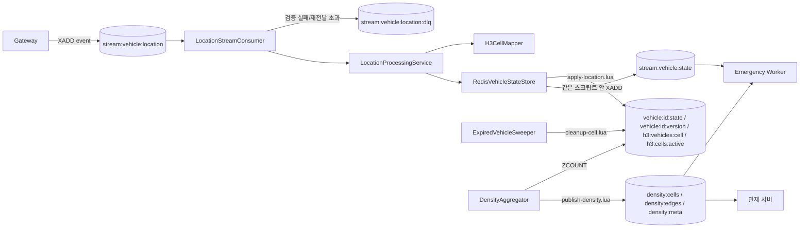

# SPEC-LOC-WORKER-001 설계

> 이 문서는 구현 방법(HOW)을 다룬다. 요구사항은 `spec.md`, 근거와 결정 기록은 `research.md`·`plan.md` §A.1.
> 설계서(`docs/상세설계서수정본_윰씨윰씨.pdf`)의 클래스 4종을 유지하고, 설계서에 없던 정리·밀도·운영 구성요소를 더한다. 표의 "출처" 열은 설계서(from-design) / 추가(added) / 변경(changed)과 결정 번호를 적는다.

---

## 1. 구성



| 구성요소 | 출처 | 책임 |
|---|---|---|
| `LocationStreamConsumer` | from-design | 그룹 준비, 시작 회수, 읽기 루프, ACK, 주기적 회수, 전달 횟수 검사, DLQ 분기, drain 종료 |
| `LocationProcessingService` | from-design | 이벤트 → 셀 계산 → 저장소 호출 |
| `H3CellMapper` | from-design | `toCell(lat, lon)` |
| `RedisVehicleStateStore` | from-design | `applyLocationUpdate`, `findById` |
| `MessageCodec` | added (C6) | `event` 필드 JSON 해석·검증 |
| `DeadLetterPublisher` | added (C7) | DLQ 기록 |
| `RedisClock` | added (D-CLK) | Redis `TIME`, 주기 ID, 다음 경계 계산 |
| `CycleClaim` | added (D-CYC) | 주기별 claim |
| `ExpiredVehicleSweeper` | added (M2) | 비활성 정리 주기 |
| `EdgeCellTable` | added (M3) | 테이블 로드·검증 |
| `DensityCalculator` | added (M3, D-ALLOC) | ρ_e 계산(순수) |
| `DensityAggregator` | added (M3) | 집계 주기, 게시 |
| `HealthServer`, `Logger`, `Metrics` | added (설계서 p4 근거) | 운영 |

---

## 2. Redis 키

| 키 | 타입 | 출처 | 내용 |
|---|---|---|---|
| `stream:vehicle:location` | Stream | from-design (p14) + changed (C6) | 그룹 `location-worker`(added). 엔트리 필드 `event` = 봉투 JSON |
| `vehicle:{vehicleId}:state` | Hash | from-design (p12) + added | 설계서 필드: vehicleId, vehicleType, latitude, longitude, speedMps, headingDegrees, h3CellId, lastSequence, lastUpdatedAt(=수신 시각 ISO, C3), status(`ACTIVE`/`INACTIVE`, 값 집합은 added). 추가 필드: lastMeasuredAt(ms, C1), stateVersion(버전 키의 사본, C5). 갱신마다 EXPIRE 3600 s(C17) |
| `vehicle:{vehicleId}:version` | String | added (D-VER) | 단조 증가 카운터, 만료 없음 |
| `h3:vehicles:{h3CellId}` | ZSET | from-design (p15) + changed (C3) | member = vehicleId, score = 수신 시각 ms |
| `h3:cells:active` | SET | added | 비어 있지 않은 셀 |
| `stream:vehicle:state` | Stream | from-design (p14) + changed (C5, C6) | 필드 `event` = 상태 이벤트 JSON, MAXLEN ~100000(C18) |
| `stream:vehicle:location:dlq` | Stream | added (C7) | 필드 `event`(원본), `reason`, `sourceId`, `deliveries`, MAXLEN ~10000 |
| `density:cells` | Hash | added (C13) | cellId → 활성 차량 수, `_generation` = 주기 ID |
| `density:edges` | Hash | added (C13) | edgeId → ρ_e, `_generation`. 엣지 밀도 비활성 시 키 없음 |
| `density:meta` | Hash | added (C13) | generation, generatedAt, intervalMs, ttlMs, h3Resolution, tableVersion, edgeDensity(`enabled` / `disabled:<사유>`) |
| `lock:location-worker:sweeper:{cycleId}`, `lock:location-worker:density:{cycleId}` | String | added (D-CYC) | 값 = instanceId, PX = 2 × 간격, 해제 없음 |

---

## 3. 원자 갱신 (`apply-location.lua`)

입력: KEYS = [상태 Hash, 버전 키, 새 셀 ZSET, `h3:cells:active`, `stream:vehicle:state`]. ARGV = vehicleId, vehicleType, lat, lon, speed, heading, newCell, sequence, measuredAtMs, measuredAtIso, ingestMs, ingestIso, G, maxlen, hashTtlSec, occurredAtIso, 셀 키 접두사.

절차:
1. Hash에서 lastSequence, lastMeasuredAt, h3CellId를 읽는다.
2. 판정
   - 저장 상태 없음 → FIRST
   - Δt = measuredAtMs − lastMeasuredAt ≤ −G → STALE
   - sequence > lastSequence → APPLIED
   - sequence = lastSequence 이고 Δt = 0 → DUPLICATE
   - sequence ≤ lastSequence 이고 Δt ≥ G → SESSION_RESET
   - 그 밖 → STALE
3. DUPLICATE/STALE이면 아무것도 쓰지 않고 `{판정}`을 반환한다.
4. 이전 셀 ≠ 새 셀이면 이전 셀 ZSET에서 ZREM 하고, ZCARD가 0이면 `h3:cells:active`에서 SREM 한다.
5. 새 셀 ZSET에 ZADD(score = ingestMs), `h3:cells:active`에 SADD 한다.
6. stateVersion = INCR 버전 키(만료 없음).
7. HSET(위치·속도·방향·유형·셀·lastSequence·lastMeasuredAt·lastUpdatedAt=ingestIso·stateVersion·status=ACTIVE), EXPIRE hashTtlSec.
8. cjson으로 상태 이벤트를 만들어 XADD MAXLEN ~ 한다. eventId = `vst-{vehicleId}-{stateVersion}`, previousH3CellId = 이전 셀(없으면 null).
9. `{판정, stateVersion, previousCell}`을 반환한다.

이전 셀 키는 스크립트 안에서 만들기 때문에 KEYS로 선언할 수 없다. 단일 Redis에서만 유효하다(C8).

상태 Hash가 만료된 뒤 늦게 도착한 이전 엔트리는 FIRST로 수용될 수 있다. 이때 score는 그 엔트리의 수신 시각이므로 읽기 주체에게는 처음부터 비활성으로 보이고, 다음 정리 주기에 `INACTIVE`가 된다.

---

## 4. 소비 흐름

1. `start()`
   1. `XGROUP CREATE stream:vehicle:location location-worker $ MKSTREAM` (BUSYGROUP이면 무시, D-GRP).
   2. 스크립트 로드. 실패하면 종료 코드 1.
   3. 시작 회수(한 번만 훑음): 커서를 `-`에서 시작해 `XPENDING stream:vehicle:location location-worker <cursor> + 100 {consumer}`로 자기 대기 엔트리 ID를 100건씩 읽는다. 페이지 안의 ID는 순서대로 하나씩, **그 엔트리를 처리하기 직전에** `XCLAIM … {consumer} 0 <id>`(ID 하나)로 다시 가져오고(전달 횟수 +1), 이어서 4번의 전달 횟수 검사를 거친 뒤 처리한다. 페이지 전체를 한 번에 XCLAIM 하지 않는다. 그래야 전달 횟수가 실제로 처리를 시도한 엔트리에서만 늘고, 앞선 엔트리가 프로세스를 죽여도 아직 시도하지 않은 뒤쪽 엔트리의 횟수는 그대로 남는다. 다음 페이지의 커서는 직전 페이지 마지막 ID의 바로 다음(`(<lastId>`)이다. 각 엔트리는 이 단계에서 **한 번만** 회수·처리된다. 처리 중 일시 오류가 난 엔트리는 대기 목록에 남기고 이 단계에서 다시 가져오지 않는다. 그 엔트리는 실행 중 주기적 회수(3번)가 마지막 전달 뒤 `PENDING_MIN_IDLE_MS` ~ 2 × `PENDING_MIN_IDLE_MS` 사이에 다시 시도한다. 페이지가 100건 미만이면 단계를 끝낸다. 이렇게 해야 일시 오류 엔트리의 전달 횟수가 시작 단계에서 순식간에 상한을 넘어 DLQ로 가는 일이 없다(AC-LW-006 (c)). 처리 중 프로세스가 죽는 엔트리는 재시작마다 한 번씩 전달 횟수가 늘어 결국 DLQ로 가고, 그 뒤에 대기 중이던 엔트리는 그때 처음 XCLAIM 되어(전달 횟수 2) 정상 처리된다(AC-LW-006 (b)). 주기적 회수(3번)의 XAUTOCLAIM은 여러 엔트리를 한 번에 가져오므로, 그 묶음을 처리하다 프로세스가 죽으면 함께 가져온 엔트리의 전달 횟수가 최대 1씩 늘 수 있다. 그 엔트리들은 다음 시작 때 이 항목별 경로로 처리된다.
   4. 읽기 루프 시작.
2. 읽기 루프: `XREADGROUP GROUP location-worker {consumer} COUNT 100 BLOCK 1000 STREAMS stream:vehicle:location >`. 엔트리마다 `handleMessage`.
3. 주기적 회수(`PENDING_MIN_IDLE_MS`마다): `XAUTOCLAIM … {consumer} PENDING_MIN_IDLE_MS 0-0 COUNT 100`을 커서가 `0-0`이 될 때까지 반복. 자기 consumer의 오래된 대기 엔트리도 포함된다. 응답의 삭제 ID는 로그만 남긴다.
4. 전달 횟수 검사(재전달 경로 공통): 1-3과 3번에서 가져온 엔트리마다 `XPENDING … <id> <id> 1`로 전달 횟수를 읽고, `MAX_DELIVERIES`를 넘으면 처리하지 않고 DLQ 기록 → XACK.
5. `handleMessage`
   - 해석·검증 실패 → DLQ 기록 → XACK
   - 처리 → 판정 결과 확정 → XACK
   - 일시 오류 → ACK 하지 않음, 경고 로그
6. `stop()`: 읽기 중단 → 진행 중 처리를 최대 `SHUTDOWN_DRAIN_TIMEOUT_MS`까지 기다림 → 못 끝낸 엔트리는 미ACK로 둠 → 타이머 해제 → 연결 종료 → 종료 코드 0.
7. 실행 중 그룹 소실(NOGROUP): 읽기·회수 명령이 NOGROUP으로 실패하면 Worker는 그룹을 자동으로 다시 만들지 않는다. error 로그(마지막으로 처리한 엔트리 ID 포함)를 남기고, readiness를 503으로 보고하며, 읽기 루프는 `BLOCK_MS` 간격으로 계속 재시도한다(liveness는 200 유지, AC-LW-008). 그룹은 운영자가 다시 만들거나 Worker 재시작(REQ-LW-001, `$`)으로 복구된다. 이때 그룹이 없던 동안 기록된 엔트리와 사라진 대기 목록은 처리되지 않는다. 그룹 소실은 운영 사고이므로, 자동 복구로 조용히 넘기지 않고 readiness로 드러내는 쪽을 택했다.
8. Redis 명령 시간 제한: 모든 명령에 `BLOCK_MS` + 1000 ms의 명령 시간 제한을 둔다(오프라인 대기열에서 무기한 머물지 않게). 읽기 루프는 명령이 성공하든 실패하든 반복할 때마다 heartbeat를 갱신하고, 실패하면 `BLOCK_MS`만큼 쉬고 다시 시도한다. heartbeat는 liveness 기한을 정한다. 기본 기한은 3 × `BLOCK_MS`이고, 시간 제한이 걸린 Redis 명령 n개로 끝나는 단계(XREADGROUP 1개, 엔트리 처리 2개) 직전에는 max(3 × `BLOCK_MS`, n × 명령 시간 제한 + `BLOCK_MS`)로 늘린다. 따라서 Redis가 끊기거나 응답을 멈춰도 루프가 살아 있으면 liveness는 `BLOCK_MS` 값과 관계없이 200이고, 루프가 명령 밖에서 멈추면 3 × `BLOCK_MS` 뒤 503이다(sync-audit F1, 2026-11-03 run-phase 수정).

consumer 이름 기본값은 `CONSUMER_NAME`(없으면 `HOSTNAME`, 그것도 없으면 `os.hostname()`)이다. 같은 이름으로 재시작하면 자기 대기 목록을 이어받는다. **동시에 도는 인스턴스는 서로 다른 consumer 이름을 가져야 한다.** 이름이 같으면 시작 회수의 `XCLAIM … 0`이 다른 인스턴스가 처리 중인 엔트리를 빼앗고 전달 횟수를 부풀린다. 호스트 이름이 겹치는 배포에서는 `CONSUMER_NAME`을 명시한다.

---

## 5. 정리와 밀도

### 5.1 주기와 claim (D-CLK, D-CYC)

- 주기 시작 시 Redis `TIME`을 한 번 읽어 now(ms)를 얻는다.
- 주기 ID = floor(now / 간격). 간격은 정리 `CLEANUP_INTERVAL_MS`, 밀도 `DENSITY_INTERVAL_MS`.
- 다음 실행은 다음 주기 경계(Redis 시각 기준) + 50 ms에 예약한다. 각 인스턴스는 주기마다 한 번 깨어난다.
- 실행 전 `SET lock:location-worker:{job}:{cycleId} {instanceId} NX PX (2 × 간격)`. 성공한 인스턴스만 실행하고 `cycle_executed` 로그(job, cycleId, instanceId)를 남긴다. 키는 갱신하지도 해제하지도 않는다. 만료될 때까지 "이 주기는 실행됨" 기록으로 남아, 같은 주기 ID에서 다른 인스턴스가 실행하지 못한다.
- 한 주기가 간격보다 오래 걸리면 다음 주기가 다른 인스턴스에서 겹쳐 실행될 수 있다. 정리는 재확인 덕분에 멱등이고, 밀도 게시는 generation 비교로 오래된 결과를 거부한다.
- "주기당 최대 1회" 보장의 전제(다중 인스턴스):
  1. 모든 인스턴스가 같은 `CLEANUP_INTERVAL_MS`와 `DENSITY_INTERVAL_MS`를 쓴다. claim 키에 간격이 들어 있지 않으므로, 간격이 다른 인스턴스끼리는 claim이 충돌하지 않아 중복 실행된다. 간격을 줄여 재시작하면 주기 ID(generation)가 작아져, 이전 `density:meta`가 만료될 때까지(최대 3 × 이전 간격) 새 게시가 거부된다.
  2. 인스턴스마다 consumer 이름이 다르다(§4).
  3. Redis 서버 시계가 2 × 간격보다 크게 거꾸로 돌아가지 않는다. `TIME`은 단조 시계가 아니라 실제 시각을 돌려주므로, 그보다 큰 역행이 있으면 claim 키가 만료된 주기 ID가 다시 나와 그 구간에서는 같은 주기 ID가 두 번 실행될 수 있다.

### 5.2 비활성 정리 (`cleanup-cell.lua`)

- 활성/비활성 구분: score > now − `INACTIVE_TTL_MS`이면 활성, 그 이하이면 비활성. 밀도 ZCOUNT의 열린 하한(설계서 p16)과 같은 경계다.
- 후보 선택은 TypeScript 쪽에서 한다: 활성 셀마다 `ZRANGEBYSCORE cell -inf cutoff LIMIT 0 SWEEP_BATCH`(cutoff = now − `INACTIVE_TTL_MS`, 닫힌 상한). 스크립트 한 번이 처리하는 양을 `SWEEP_BATCH`로 묶어 큰 셀 때문에 Redis가 오래 막히지 않게 했다. 한 셀에서 선택→스크립트를 반복하다가, 선택 결과가 `SWEEP_BATCH`보다 적으면 그 셀을 끝낸다. 재확인에서 살아남은 차량은 score가 cutoff보다 커졌으므로 다음 선택에 다시 나오지 않는다. 따라서 주기가 끝나면 cutoff 이하 멤버가 모두 정리된다(REQ-LW-020).
- 스크립트: KEYS = [셀 ZSET, `h3:cells:active`], ARGV = cutoff, cellId, 상태 키 접두사, 후보 ID들. 후보마다 ZSCORE를 다시 읽어 값이 있고 cutoff 이하일 때만 ZREM 하고, 그 차량의 상태 Hash가 있고 h3CellId가 이 셀이면 `status=INACTIVE`. ZCARD = 0이면 SREM.
- 후보 선택과 스크립트 실행 사이에 갱신된 차량은 ZSCORE가 cutoff보다 커졌거나(같은 셀) 이 셀에 없으므로(다른 셀로 이동) 그대로 남는다. AC-LW-020은 이 사이에 장애 주입 훅을 넣어 시험한다.

### 5.3 밀도 계산

테이블 형식:

```json
{
  "schemaVersion": 1,
  "h3Resolution": 9,
  "source": "sumo-net",
  "generatedAt": "2026-11-02T00:00:00.000Z",
  "edges": {
    "EDGE-101": { "lengthM": 400, "lanes": 2, "cells": { "8930e0a845bffff": 300, "8930e1d8c0bffff": 100 } }
  }
}
```

예시 셀 ID는 h3-js 4.5.0 `latLngToCell`로 계산한 Res 9 값이다. `8930e0a845bffff`는 (37.4501, 126.6532), `8930e1d8c0bffff`는 (37.5665, 126.9780)의 셀이다. 처음 적었던 `892a100d2c3ffff`·`892a100d2c7ffff`는 유효한 Res 9 셀이지만 중심이 뉴욕(약 40.75, -73.99)이어서 바꿨다(run-phase M1a 확인, 2026-11-03).

- 검증: schemaVersion = 1, h3Resolution = `H3_RESOLUTION`, lanes ≥ 1, lengthM > 0, 셀 ID 유효, 셀 안 길이 > 0, 엣지 ID가 `_`로 시작하지 않음(`_generation` 필드와 충돌 방지).
- 셀 c 안 엣지 e의 가중치 w(e,c) = cells[c] × lanes(e) (D-ALLOC, 추가 규칙)
- 몫 s(e,c) = w(e,c) / Σ w(·,c)
- n_e = Σ_c count_c × s(e,c)
- ρ_e = n_e / ((lengthM / 1000) × lanes) [대/km/차로]

셀 수는 테이블과 무관하게 항상 계산한다. 활성 셀 중 테이블에 없는 셀의 차량은 엣지 밀도에 반영되지 않는다(셀 수에는 반영).

### 5.4 원자 게시 (`publish-density.lua`, D-PUB)

- KEYS = [`density:cells`, `density:edges`, `density:meta`]. ARGV = generation, expiryMs, 셀 수 쌍 목록, 엣지 밀도 활성 여부, 엣지 값 쌍 목록, meta 필드.
- 새 generation이 `density:meta`에 저장된 generation 이하이면(저장된 값이 있을 때) 아무것도 바꾸지 않고 `SKIPPED_STALE_GENERATION`을 반환한다. 저장된 값이 없거나 새 generation이 더 크면 교체한다(REQ-LW-024, D-PUB).
- 교체할 때는 세 키를 DEL 한 뒤, cells에 셀 수와 `_generation`, edges에 엣지 값과 `_generation`(비활성이면 생략해 키 없음), meta에 필드를 HSET 하고, 세 키 모두 PEXPIRE expiryMs.
- HSET은 스크립트 안에서 500쌍 단위로 나눠 호출한다. Lua의 `unpack` 인자 수 제한(Redis 내장 Lua 5.1에서 수천 개 수준으로 알려져 있으나 확인하지 않음)에 걸리지 않게 하기 위해서다. 도시 규모 SUMO 네트워크는 엣지가 수만 개에 이를 수 있다. 시험 전략에 엣지 10,000개 fixture 게시 시험을 둔다(plan.md §F.1).
- 임시 키를 쓰지 않으므로 임시 키 누수가 없다. 셀이 하나도 없으면 cells에는 `_generation`만 들어간다.

---

## 6. 설정

| 변수 | 기본값 | 범위 |
|---|---|---|
| `REDIS_URL` | `redis://localhost:6379` | |
| `H3_RESOLUTION` | 9 | 8~9 |
| `INACTIVE_TTL_MS` | 5000 | > 0 |
| `SEQUENCE_RESET_GAP_MS` | 1000 | > 0 |
| `MAX_FUTURE_SKEW_MS` | 2000 | ≥ 0 |
| `READ_COUNT` / `BLOCK_MS` | 100 / 1000 | |
| `PENDING_MIN_IDLE_MS` | 10000 | |
| `MAX_DELIVERIES` | 5 | ≥ 1 |
| `CLEANUP_INTERVAL_MS` | 1000 | |
| `SWEEP_BATCH` | 500 | ≥ 1 |
| `DENSITY_INTERVAL_MS` | 2000 | 1000~3000 |
| `EDGE_CELL_TABLE_PATH` | (설정 안 함 = 테이블 없음으로 취급 → REQ-LW-025대로 엣지 밀도 비활성, error 로그, readiness 상세 표시, 셀 수는 게시) | |
| `STATE_STREAM_MAXLEN` | 100000 | |
| `DLQ_MAXLEN` | 10000 | |
| `STATE_HASH_TTL_SEC` | 3600 | |
| `SHUTDOWN_DRAIN_TIMEOUT_MS` | 10000 | |
| `HEALTH_PORT` | 8080 | |
| `CONSUMER_NAME` | `HOSTNAME` | 인스턴스마다 달라야 함 |
| `INSTANCE_ID` | `{hostname}-{pid}` | |

범위를 벗어나면 시작 시 종료 코드 1.

---

## 7. 운영

- 로그: stdout에 한 줄 JSON(`ts`, `level`, `msg`, `outcome`, `entryId`, `vehicleId`, `latencyMs`). 입력 봉투의 `producer`는 `src/consumer`에서 로그에만 기록하고 판단에 쓰지 않는다. 출력 이벤트의 `producer: "location-worker"`는 `apply-location.lua`가 상수로 기록한다(REQ-LW-018). AC-LW-007 정적 검사는 이 둘을 구분한다.
- `latencyMs` = 상태 이벤트 기록 시각 − 엔트리 ID 시각.
- `/healthz`: 현재 시각이 읽기 루프의 liveness 기한(`liveUntil`) 이하이면 200, 지나면 503. 기한은 heartbeat마다 다시 정해진다. 시작할 때, 루프 반복을 시작할 때, Redis 오류 뒤 재시도 대기에 들어갈 때는 now + 3 × `BLOCK_MS`이고, XREADGROUP 직전에는 now + max(3 × `BLOCK_MS`, 명령 시간 제한 + `BLOCK_MS`), 엔트리 하나를 처리하기 직전에는 now + max(3 × `BLOCK_MS`, 2 × 명령 시간 제한 + `BLOCK_MS`)다(명령 시간 제한 = `BLOCK_MS` + 1000 ms). 따라서 Redis가 끊기거나 응답을 멈춰도 루프가 살아 있으면 200이고, 루프가 명령 밖에서 멈추면 3 × `BLOCK_MS` 뒤 503이다(§4 8번).
- `/readyz`: Redis PING 성공 + `XINFO GROUPS`에 `location-worker` 존재 → 200, 아니면 503. 본문에 대기 건수, 판정 카운터, 엣지 밀도 상태(활성/비활성 사유).
- 종료 코드: 정상 종료(drain 포함) 0, 복구 불가 오류 1.

## 8. 알려진 제약

- 비활성 전환 이벤트 없음(C16): Emergency Worker는 상태 스트림으로 비활성 차량의 알림을 해제할 수 없다. Alert Worker 만료가 최종 해제 경로다.
- 셀 → 엣지 배분은 방향을 구분하지 않는다.
- 버전 키는 만료하지 않는다.
- 스크립트 안 키 계산 때문에 Redis Cluster 비호환.
